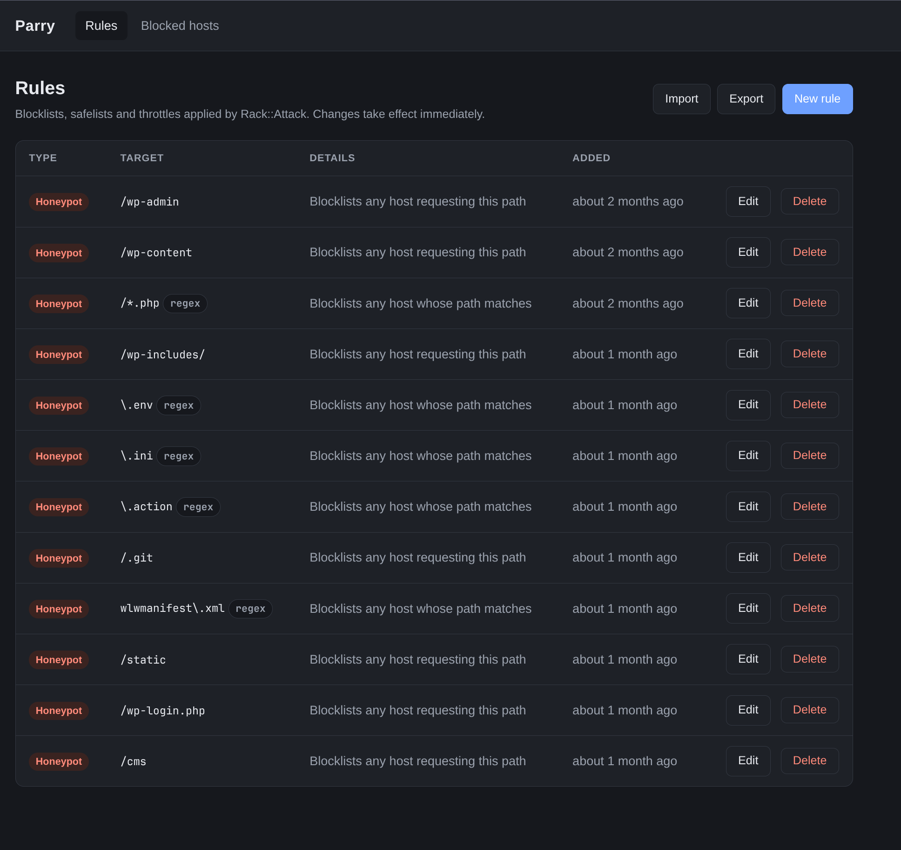
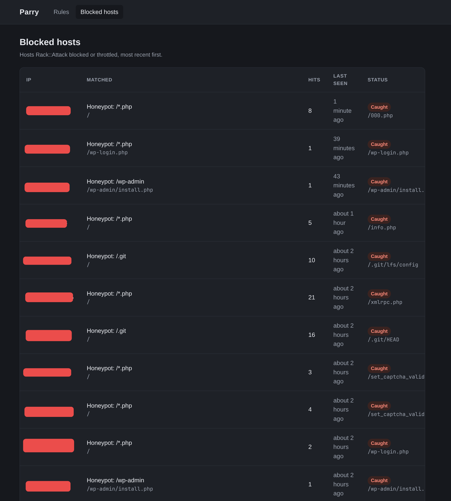

# Parry

Parry is a mountable Rails engine that puts a GUI in front of [Rack::Attack](https://github.com/rack/rack-attack).



Rack::Attack rules normally live in an initializer, so changing them means a deploy. Parry keeps its rules in
your database (through ActiveRecord) or in Redis instead, and applies them to every application process as soon as
you save them:

- manage **blocklists**, **safelists**, **throttles** and **honeypots** from a web page
- see the hosts that were **blocked or throttled**, with hit counts and the rule they matched
- **unblock** a host: the blocklist rules covering it are deleted and its throttle counters are reset



Parry has no opinion about authentication - mount it behind whatever your application already uses.

## Installation

```ruby
# Gemfile
gem "parry"
```

Parry stores its rules in Redis by default (see [Redis](#redis-default) for the connection settings). To keep them
in your application's database instead, create the tables:

```sh
bin/rails generate parry:install
bin/rails db:migrate
```

The generator writes a migration for four tables - `parry_rules`, `parry_versions`, `parry_blocked_hosts` and
`parry_caught_hosts` - and a `config/initializers/parry.rb` that selects the ActiveRecord backend. PostgreSQL,
MySQL/MariaDB and SQLite are supported. See [Storage backends](#storage-backends) for both backends.

Make sure Rack::Attack itself is set up in your application:

```ruby
# config/application.rb
config.middleware.use Rack::Attack
```

**Rack::Attack does not need Redis.** Safelists and blocklists - which is what Parry's blocklist, safelist and
honeypot rules are - never touch its cache. Only throttles (and `Fail2Ban`/`Allow2Ban`) count requests, and for
those any ActiveSupport cache store that supports `increment` and is shared by all your processes will do.
[Solid Cache](https://github.com/rails/solid_cache), the Rails 8 default, is a good fit:

```ruby
# config/initializers/rack_attack.rb
Rack::Attack.cache.store = SolidCache::Store.new
# or reuse the application cache when it is already Solid Cache:
# Rack::Attack.cache.store = Rails.cache
```

Redis or Memcached work just as well if you already run one:

```ruby
Rack::Attack.cache.store = ActiveSupport::Cache::RedisCacheStore.new(url: ENV["REDIS_URL"])
# Rack::Attack.cache.store = ActiveSupport::Cache::MemCacheStore.new(ENV["MEMCACHE_SERVERS"])
```

Then mount the engine:

```ruby
# config/routes.rb
mount Parry::Engine => "/parry"
```

## Authentication

The engine is deliberately unauthenticated, so restrict it when you mount it. With Devise:

```ruby
authenticate :user, ->(user) { user.admin? } do
  mount Parry::Engine => "/parry"
end
```

With HTTP basic auth:

```ruby
Parry::Engine.middleware.use(Rack::Auth::Basic) do |username, password|
  ActiveSupport::SecurityUtils.secure_compare(username, ENV.fetch("PARRY_USER")) &
    ActiveSupport::SecurityUtils.secure_compare(password, ENV.fetch("PARRY_PASSWORD"))
end

mount Parry::Engine => "/parry"
```

Or with a route constraint:

```ruby
constraints ->(request) { request.session[:admin] } do
  mount Parry::Engine => "/parry"
end
```

## Configuration

```ruby
# config/initializers/parry.rb
Parry.configure do |config|
  # Where rules, caught hosts and blocked hosts are stored: :redis or :active_record.
  # Default: :redis.
  config.backend = :redis

  # Register the Rack::Attack hooks on boot. Default: true.
  # Set to false to call Parry.install! yourself.
  config.auto_install = true

  # Record blocked and throttled requests for the "Blocked hosts" page. Default: true.
  config.track_events = true

  # How many hosts that page keeps, oldest dropped first. Default: 1000.
  # The page itself lists them 50 at a time.
  config.max_tracked_hosts = 1_000

  # Seconds a honeypot regex may spend on one path before it is abandoned.
  # Default: 0.05.
  config.regex_timeout = 0.05
end
```

The options specific to each backend are described below.

## Storage backends

### ActiveRecord

Rules, caught hosts and blocked hosts live in the tables `rails generate parry:install` creates. Two things happen
on the request path, and both are kept cheap:

- **The rules version is checked on every request**, to pick up changes made by other processes. The ActiveRecord
  backend does not query for it every time: each process caches it for `version_cache_ttl` seconds. A change
  made through the GUI or console applies at once in the process that made it, and in every other process within
  the TTL.
- **Every blocked or throttled request is recorded** for the Blocked hosts page. That is a single upsert (add a
  hit, set `last_seen`, keep `first_seen`). Trimming the table to `max_tracked_hosts` only runs every
  `tracker_trim_every` records or `tracker_trim_interval` seconds, whichever comes first, so the table can briefly
  hold a few more hosts than the limit. `tracker_write_interval` additionally caps how often one address is
  written: under a flood from one IP its hits are counted in memory and added by the next write.

```ruby
Parry.configure do |config|
  config.backend = :active_record

  # Seconds a process trusts the rules version it last read. 0 checks on every
  # request. Default: 2.
  config.version_cache_ttl = 2

  # Trim the blocked hosts table after this many records... Default: 1000.
  config.tracker_trim_every = 1_000
  # ...or after this many seconds. nil disables the time trigger. Default: 60.
  # With both off (nil) the table is trimmed on every record.
  config.tracker_trim_interval = 60

  # Write a given address at most once per this many seconds. Default: nil (every hit).
  config.tracker_write_interval = 5

  # Use a database of its own for Parry's tables. Default: nil (the primary database).
  config.connects_to = {database: {writing: :parry}}
end
```

`Parry.tracker.trim!` trims the table on demand, if you would rather do it from a scheduled job.

#### A separate database

Parry's models inherit from an abstract `Parry::ApplicationRecord`, and `config.connects_to` is handed to its
`connects_to`. To keep Parry's tables apart from your own, add a database to `config/database.yml`:

```yaml
production:
  primary:
    <<: *default
    database: my_app
  parry:
    <<: *default
    database: my_app_parry
    migrations_paths: db/parry_migrate
```

generate the migration into it and point Parry at it:

```sh
bin/rails generate parry:install --database=parry
bin/rails db:migrate
```

```ruby
Parry.configure do |config|
  config.connects_to = {database: {writing: :parry}}
end
```

Set `connects_to` in an initializer: it is applied the first time Parry touches the database.

### Redis (default)

```ruby
Parry.configure do |config|
  config.backend = :redis

  # Redis client. Defaults to Redis.new(url: ENV["PARRY_REDIS_URL"] || ENV["REDIS_URL"]).
  # A ConnectionPool works too - anything that responds to #with.
  config.redis = Redis.new(url: ENV["PARRY_REDIS_URL"])

  # Prefix for every key Parry writes. Default: "parry".
  config.key_prefix = "parry"
end
```

The Redis backend checks the version with one `GET` per request and trims the blocked hosts list on every record; the
ActiveRecord-only options above do not apply to it.

## Redis persistence

This section only applies to the [Redis backend](#redis-default). Parry's rules and the hosts its honeypots caught are
**data, not cache**. If the Redis holding them loses its contents, your rules are gone and every host you blocked
is free again. Two ways that happens:

**A Redis container without a volume.** Everything lives in the container's writable layer, so anything that
recreates the container - a redeploy, `docker compose up --force-recreate`, a host rebuild - wipes it. Give it a
volume and turn on the append-only file:

```yaml
services:
  redis:
    image: redis:7-alpine
    command: redis-server --appendonly yes
    volumes:
      - ./tmp/redis:/data
```

With Kamal, run Redis as an accessory with a directory of its own:

```yaml
# config/deploy.yml
accessories:
  redis:
    image: redis:7-alpine
    host: 203.0.113.10
    cmd: redis-server --appendonly yes
    directories:
      - data:/data
```

`directories` bind-mounts a directory on the host into the container, so the data outlives any container that
gets replaced. Without it the accessory keeps everything inside the container, and the first
`kamal accessory reboot redis` - or anything else that recreates it - starts from an empty database.

**A Redis used as a cache.** With a `maxmemory` limit and an eviction policy like `allkeys-lru`, Redis quietly
drops keys when it fills up, and it does not exempt yours. Either run the instance with `noeviction`, or point
Parry somewhere else with `PARRY_REDIS_URL` - a separate database on the same server is enough:

```ruby
Parry.configure do |config|
  config.redis = Redis.new(url: ENV.fetch("PARRY_REDIS_URL"))
end
```

To check what a running server is doing:

```sh
redis-cli config get appendonly
redis-cli config get maxmemory-policy
```

## Rule types

| Type | Effect |
| --- | --- |
| Blocklist | Requests from the IP or CIDR range get `403 Forbidden` |
| Safelist | Requests from the IP or CIDR range skip every blocklist, throttle and honeypot |
| Throttle | More than *limit* requests per *period* seconds from one IP get `429 Too Many Requests`, optionally only under a path prefix |
| Honeypot | Requesting the path - by prefix or regex - blocklists the host, so all of its later requests get `403 Forbidden` too |

Both IPv4 and IPv6 addresses and ranges are accepted.

### Honeypots

A honeypot turns a path into bait. The first request to it gets a `403`, and the host is blocked everywhere
until you release it:

```
GET /.env  from 203.0.113.9   -> 403, host caught
GET /      from 203.0.113.9   -> 403, still blocked
GET /      from 198.51.100.1  -> 200
```

Point honeypots at paths a real visitor never requests - `/.env`, `/wp-login.php`, `/.git/config` - and they will
catch the scanners probing for them. Caught hosts show up under **Blocked hosts** as `Caught`, together with
the path that caught them, and the Unblock button releases them.

A honeypot matches its path in one of two ways:

**Prefix** (the default) - `/wp-login.php` also catches `/wp-login.php.bak`, and `/admin` catches everything
below `/admin`.

**Regular expression** - one rule can cover a family of probes:

| Pattern | Catches |
| --- | --- |
| `\.(env\|git)` | `/.env`, `/.git/config`, `/config/.env` |
| `\A/(wp-admin\|wp-login)` | `/wp-admin/`, `/wp-login.php` |
| `\.(php\|asp\|aspx)\z` | any request ending in a PHP or ASP extension |

The pattern is ordinary Ruby regex syntax and is **matched anywhere in the path unless you anchor it** with `\A`
or `\z`. Bear in mind the path always starts with `/`, so `\Awp-` never matches anything - you want `\A/wp-`.

Whichever you choose, pick it carefully: anything a legitimate visitor can reach blocks them, so `/` as a prefix
honeypots your entire audience. Safelist your own address before arming a broad one.

Regexes are compiled with a timeout (`config.regex_timeout`, 50ms by default) because they run against every
request path. A pattern that backtracks catastrophically is abandoned and logged rather than allowed to hang the
request, and a pattern that does not compile is rejected by the form.

## Export and import

The rules list has **Export** and **Import** buttons. Export downloads every rule as JSON; import reads that
file back, either adding to the rules already there or replacing them outright.

```json
{
  "format": 1,
  "parry_version": "0.1.0",
  "exported_at": 1787390429,
  "rules": [
    {"id": "3f2a...", "kind": "honeypot", "path": "\\.(env|git)", "path_match": "regex", "name": "Config probe"}
  ]
}
```

Use it to keep a backup of a hand-built rule set, to move rules from staging to production, or to keep the
same honeypots across several applications. Rules keep their ids, so re-importing the same file updates the
rules it already created instead of duplicating them.

## Starter honeypot rules

Import this JSON to set up a starter set of honeypots that catch common scanner probes:

```json
{
  "format": 1,
  "parry_version": "0.1.0",
  "exported_at": 1792154664,
  "rules": [
    {"id": "81b72099bb9ee0b8", "kind": "honeypot", "path": "/wp-admin", "path_match": "prefix", "created_at": 1787485029},
    {"id": "1cab2f085efd96c2", "kind": "honeypot", "path": "/wp-content", "path_match": "prefix", "created_at": 1787485038},
    {"id": "319a068bd3ecf2a8", "kind": "honeypot", "path": "/*.php", "path_match": "regex", "created_at": 1787485046},
    {"id": "45a6a5aa4ce9d553", "kind": "honeypot", "path": "/wp-includes/", "path_match": "prefix", "created_at": 1789592763},
    {"id": "981ed0b90c9b82ac", "kind": "honeypot", "path": "\\.env", "path_match": "regex", "created_at": 1789592836},
    {"id": "774556062efe2222", "kind": "honeypot", "path": "\\.ini", "path_match": "regex", "created_at": 1789592872},
    {"id": "ca7a15b798c13b50", "kind": "honeypot", "path": "\\.action", "path_match": "regex", "created_at": 1789592892},
    {"id": "ad18ef756734ab61", "kind": "honeypot", "path": "/.git", "path_match": "prefix", "created_at": 1789632673},
    {"id": "fd4f5f92ceb0f812", "kind": "honeypot", "path": "wlwmanifest\\.xml", "path_match": "regex", "created_at": 1789632707},
    {"id": "ea747ec75c548815", "kind": "honeypot", "path": "/static", "path_match": "prefix", "created_at": 1789632734},
    {"id": "f91a2c1cc24a7722", "kind": "honeypot", "path": "/wp-login.php", "path_match": "prefix", "created_at": 1789632748},
    {"id": "9a81543ea9c5df68", "kind": "honeypot", "path": "/cms", "path_match": "prefix", "created_at": 1789632834},
    {"id": "5c0b3f04946a1eb9", "kind": "honeypot", "path": "/backup", "path_match": "prefix", "created_at": 1792154602},
    {"id": "61a8b763a94d5154", "kind": "honeypot", "path": "/sftp-config.json", "path_match": "prefix", "created_at": 1792154628},
    {"id": "67b7f40a073d3234", "kind": "honeypot", "path": "/version", "path_match": "prefix", "created_at": 1792154643},
    {"id": "70b36a2230e03379", "kind": "honeypot", "path": "/docker-compose.yml", "path_match": "prefix", "created_at": 1792154659}
  ]
}
```

The set covers WordPress, `.env`, `.git`, backup files, and other common probes. Import it from the GUI or
from the Rails console:

```ruby
json = File.read("starter-honeypots.json")
Parry::RuleTransfer.import(json, replace: false)
```

**An import is all or nothing.** Every rule in the file is validated as it is applied, and if any one of them is
rejected the whole import is rolled back and each problem is listed - a file with a typo in it can never leave
you with half a rule set. That holds for "replace" too: the rules you have now are only let go once the
replacement is known to be good.

The same thing from a console, if you would rather script it:

```ruby
File.write("rules.json", Parry::RuleTransfer.export_json)

result = Parry::RuleTransfer.import(File.read("rules.json"), replace: true)
result.ok?       # => true
result.imported  # => 3
result.errors    # => []
```

Blocked and caught hosts are deliberately not part of an export - they are a record of what happened on one
server, not configuration.

## How it works

Parry registers exactly one safelist and one blocklist check with Rack::Attack, plus one real
`Rack::Attack.throttle` per throttle rule. Rules are stored next to a version counter that is bumped on every
write, and caught hosts bump the same counter. The safelist check runs on every request and compares that counter
against the snapshot the process is holding, reloading the rules when it changed - so an edit made in one process
is picked up by all of them. With the ActiveRecord backend the counter is read at most once per
`version_cache_ttl`; with Redis it costs one `GET` per request.

Rules you define yourself in an initializer keep working; Parry only adds to them.

If the database or Redis is unreachable, Parry logs the error and keeps serving the last snapshot it loaded rather
than taking requests down with it. A failure to record a blocked host is logged and never fails the request.

## Unblocking yourself from the Rails console

If a rule locks you out of the Parry GUI, open your application's Rails console and unblock your IP address:

```ruby
Parry.unblock("203.0.113.4")
```

This removes Parry blocklist rules covering the address, releases it from any honeypot, and resets its current
throttle counters.

## Things worth knowing

- **The rules apply to the GUI too.** A throttle without a path prefix counts your own visits to the Parry pages,
  and if your address ends up blocklisted you will not be able to reach them. Safelisting the address you
  administer from avoids locking yourself out.
- **A caught host stays blocked when you delete the honeypot rule.** The rule is the sensor, the caught host is
  the result: removing the sensor does not vouch for the hosts it already caught. Release them individually from
  the Blocked hosts page.
- **Safelist yourself before arming a broad honeypot.** The safelist check runs first, so a safelisted address can
  never be caught - it is the way back in if a honeypot turns out to cover more than you meant.
- **Unblock only removes Parry's own rules.** Blocklists written in your initializer are static Ruby, so the GUI
  cannot delete them - it reports the throttle counters it reset instead.
- **Unblock clears the current throttle window** for every registered throttle, including throttles your own
  initializer defines, and releases the host from any honeypot. Counters from `Fail2Ban` and `Allow2Ban` are not
  touched.
- **Use a shared cache store.** With the default in-memory store each process counts separately and unblocking
  only affects the process that handled the request.
- **On the Redis backend, give Redis a volume.** Rules and caught hosts do not survive a container that gets
  recreated without one - see [Redis persistence](#redis-persistence).

## Development

The same test suite runs against every storage backend, using a dummy Rails application:

```sh
bin/setup
bundle exec rake test            # ActiveRecord on SQLite, no services needed
docker compose up -d             # Redis on 6380, MySQL on 3307
docker compose --profile postgres up -d   # also PostgreSQL on 5432, if you do not run one already
bundle exec rake test:redis
bundle exec rake test:postgres
bundle exec rake test:mysql
bundle exec rake                 # every backend + standard
```

The SQLite run keeps Parry's tables in a database of their own through `config.connects_to`; the PostgreSQL and
MySQL runs share the primary connection. The PostgreSQL run uses the server on `127.0.0.1:5432` as `postgres`
(password from `PGPASSWORD`; the compose service needs none) and creates `parry_test` if it is missing. `PARRY_TEST_POSTGRES_URL`, `PARRY_TEST_MYSQL_URL` and
`PARRY_TEST_REDIS_URL` point the suite elsewhere - it only accepts local servers, since every test wipes Parry's
data.

To click through the GUI, boot the dummy application (`PARRY_TEST_BACKEND` picks the backend, SQLite by default):

```sh
bundle exec puma test/dummy/config.ru -p 3210
# or: PARRY_TEST_BACKEND=redis REDIS_URL=redis://127.0.0.1:6380/2 bundle exec puma test/dummy/config.ru -p 3210
# then open http://127.0.0.1:3210/parry
```

## Contributing

Bug reports and pull requests are welcome at https://github.com/gregmolnar/parry.

## License

The gem is available as open source under the terms of the [MIT License](https://opensource.org/licenses/MIT).
